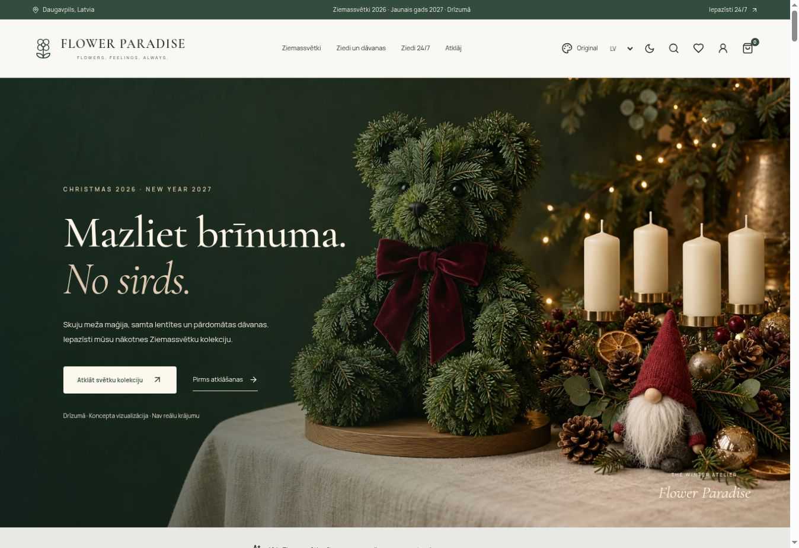

# Flower Paradise

A premium, Latvian-first floral boutique demonstration for Daugavpils, Latvia. React 19, TypeScript, Vite, Tailwind CSS, React Router, Lucide and Motion. Original implementation; no template code copied.

## Run and validate

Node 22 or later. `npm ci`, then `npm run dev`. Production: `npm run build`. Quality checks: `npm run lint`, `npm run typecheck`, `npm test`. Route chunks load on demand.

## Experience

186 translated product records: 36 original flower/gift products and 150 Christmas 2026 / New Year 2027 concepts, including seven physical Advent calendar concepts across 21 collections; search, category/price/occasion/colour filtering and sorting; quick view; product galleries; quantities, gift messages and cards; cart, wishlist, BLOOM10 demo promotion and validated checkout. A bespoke bouquet configurator updates its price dynamically. The four-compartment vending simulator supports reservations, simulated payments, one-use codes and unlocking. Future reservations reject matching local time slots. Important dates support create/edit/delete, annual recurrence, notification previews, snoozing and dismissal. Gifts include scheduled recipient previews and one-use demo certificate redemption. Weekly, fortnightly and monthly subscriptions have duration, preference and collection options.

Customer and administrative dashboards share browser-local state. Product edits update catalog names, prices and stock locally. Admin analytics are explicitly illustrative; order/reservation/subscription views reflect the actual demo activity in this browser. Admin discount campaigns and BLOOM10 use the shared checkout pricing logic. No authentication, backend, card fields, real transactions, real messages or real hardware. Use fictional form values. Newsletter and corporate forms are local simulations. Privacy controls reset all demo business data.

All interface copy, product names and descriptions are available in Latvian, Russian and English. Latvian/light mode default; language and theme persist. Keyboard focus indicators, native focus-trapping dialogs, responsive layouts and reduced-motion support are included.

## GitHub Pages

Repository identity is **a-zcare/FlowerParadise**, so the case-sensitive Pages URL is **https://a-zcare.github.io/FlowerParadise/**. It is not the requested lowercase, hyphenated path. No root `a-zcare.github.io` repository is modified. `vite.config.ts` sets `/FlowerParadise/`. Hash routing (`/#/shop`, `/#/product/fp-1`) ensures direct entry and refresh work on static Pages without rewrite infrastructure. This deliberately favours reliable refreshes over server-style route paths. The sitemap contains the canonical index; search engines do not independently index hash routes.

`.github/workflows/pages.yml` installs dependencies, runs ESLint, TypeScript, Vitest, the production dependency audit, the production build and Playwright before packaging the Pages artifact. A restricted publication job updates only the existing `gh-pages` branch and requests GitHub’s native Pages build. This respects the environment rule that allows `gh-pages` but rejects `main`; no environment protections are changed.

The repository is public and Pages is configured for **Deploy from a branch → gh-pages → /(root)**. For future owner setup, preserve that branch source. Run the quality workflow on main after changes, then verify both the workflow and native Pages deployment. If an organization restricts the workflow token’s write permissions, an owner must allow publication to this branch or publish the verified artifact with an authorized connection.

The repository is not renamed. If the owner later renames it to `flower-paradise`, update the Vite base, manifest, worker scope, icon paths, metadata, robots, sitemap and publication instructions together.

## Photography and references

Photographs are illustrative style references, not promises of identical commercial inventory. Sources are Unsplash free-license photographs (https://unsplash.com/license), served as optimized WebP assets. Source IDs are preserved in asset filenames; see `src/data.ts`. Third-party fonts: locally hosted subsets of Cormorant Garamond and Manrope from Google Fonts (SIL Open Font License). Lucide icons use the ISC license. Dependency licenses remain with their authors.

Reference review: [Themixly floral template](https://github.com/themixlyweb/react-flower-shop-website-template) for editorial sections (repository describes MIT/free restrictions inconsistently; nothing copied), [snmada flower-shop](https://github.com/snmada/flower-shop) for filter/admin interaction concepts (no code/assets reused), [Epic Design Labs ecommerce starter](https://github.com/Epic-Design-Labs/nextjs-ecommerce-starter) for cart/wishlist/checkout patterns (MIT; no code/assets reused). The app uses a small Context store rather than a backend or complex state library.

Future integration points: replace local order/reservation writes with verified server requests; validate stock and slot allocation server-side; use provider-generated pickup codes and transactional notifications; integrate a payment provider only with a secure backend. The current frontend is a complete demonstration, not a production transaction system.

## Version 2 platform

Shared versioned browser storage coordinates stock, inventory batches, vending, reservations, cart, orders, gifts and admin edits. Migration accepts valid version 1 records; corrupted or unavailable storage falls back safely. Reset clears all demo business records. Actual bouquet photo previews stay in memory and disappear on refresh.

Discovery includes a seven-step transparent Flower Match, immediate availability, comparison of three products, budget gift combinations and bouquet passports. Gifting includes personalized local reveals, certificates, annual planning, current-price reorder and home/corporate subscriptions. Operations include batch freshness, FEFO rotation, waste costs, maintenance records, scoped promotional campaigns and an editable profitability/capacity simulator. Financial results are assumptions before tax, not forecasts or advice.

The PWA precaches the application shell and route chunks, supports an offline fallback and offers explicit updates. No real push notifications. Local fonts and optimized photographs avoid runtime font/image services. All sample inventory, analytics and maintenance records are clearly demonstration data.

## Validation

Run `npm run lint`, `npm run typecheck`, `npm test`, `npm run build`, then `npx playwright install chromium` and `npm run test:e2e`. The production Playwright suite covers shopping, recommendations, comparison, vending, reservations, gifting, reminders, operations, reset, language persistence, offline loading and responsive layouts at 320, 375, 390, 430, 768, 1024, 1440 and 1920 pixels plus landscape sizes. GitHub Actions runs these checks before deploying; failed browser reports are retained as artifacts.

Release validation: 78 Vitest tests and 45 Chromium Playwright tests passed, together with ESLint, TypeScript, the production dependency audit and production build. [Quality workflow 40762651747](https://github.com/a-zcare/FlowerParadise/actions/runs/40762651747) validated source commit `fbf969ed0269dca3aaa50feb9694444ecfb13a4e`. Native [Pages deployment 40763010969](https://github.com/a-zcare/FlowerParadise/actions/runs/40763010969) published artifact commit `264fc3d34e5181be4997802df43c82d658132fb9`. The Christmas homepage was opened and visually verified at https://a-zcare.github.io/FlowerParadise/. No repository rename or visibility change was performed.

## Christmas 2026 / New Year 2027 extension

The Christmas campaign is enabled for 1 October 2026–7 January 2027, Riga calendar dates. Admin → Christmas studio changes activation, pre-launch mode, featured products and collection order locally. Disabling the campaign restores the original homepage. Flowers remain at `/shop`; the shared seasonal catalog is `/christmas`. The Christmas gift builder, personalization, quantity-aware preorders, 24-window Advent calendar, theme gallery, pre-launch survey and notification center extend the shared local state. Survey answers and product interest are browser-local and invisible to the business; the launch form does not retain the entered demo email. The lead adapter never submits to a server. Notification logs are simulations with separate transactional/marketing/admin preferences.

Fifteen visual themes are available: Original / Current Design, Floral Elegance, Midnight Bloom, Botanical Calm, Colorful Garden, Pure Minimal, Lavender Dream, Emerald Luxury, Parisian Romance, Nordic Bloom, Sunset Blossom, Zen Garden, Art Deco Bloom, Blue Serenity and Modern Pop. The original light/dark controls are preserved. Themes share semantic tokens, vary typography and component structure, persist independently of language/cart, and support search, favorites, recent choices and comparison of identical content. Head bootstrap avoids a theme flash.

Holiday photography is **style inspiration**, not exact product or stock photography. Twelve original AI concept product visuals and one original hero are combined with curated free-license Unsplash images; repeated representative photographs are labeled as style references. Sources and license links are in `public/seasonal/image-credits.json`. Supplier photographs can replace the centralized imagery map without altering product IDs. Materials, dimensions, prices and manufacturing options are demo assumptions. Candle/fire, small-parts, decorative-berry and food/cosmetic labeling warnings are shown on relevant product pages. Physical Advent calendars are empty display concepts, without promised gifts.

### Publication constraints

The GitHub environment permits `gh-pages` and rejects `main`. The workflow therefore tests source on main, publishes the tested artifact to the permitted branch, then requests the native Pages build. No environment protection rules are weakened. The Christmas platform is published and verified at https://a-zcare.github.io/FlowerParadise/ (source `fbf969e`, Pages `264fc3d`). The lowercase requested path remains unavailable because the repository is named FlowerParadise; it is preserved as requested.

## Published preview

## Premium discovery update

Desktop navigation uses a dedicated discovery row and a labeled Styles control with the current theme and palette. All 15 themes remain available, with searchable/favorite/recent choices and identical-content comparisons at simulated 1440px and 390px widths. Pickup discovery filters the shared catalog by method and planned location; maintenance hides vending stock and blocks local reservations. No business address or live stock is invented. Ten original LV/RU/EN guides and a service explanation page connect the catalog, gifting and pickup flows.

The gift atelier links to dedicated wreath and Advent calendar builders. They use the shared product inventory, size pricing, wrapping, greeting cards, dates and cart. Calendar concepts support 24 personal messages/activities; physical contents are excluded. Changes are schematic previews; reference photography does not depict a configured final item. Notes survive reload up to 4,000 characters. Catalog migration adds the 38 new SKUs without replenishing depleted existing batches.

Admin → Experience studio controls local pickup availability, editorial visibility/notes, FAQ and style previews. Admin → Catalog tools exports/imports JSON for known product IDs and previews bulk price changes before applying them. Imports validate the entire batch, all three translations, unique known IDs and prices €1–€500 before any update. These tools affect this browser only; no server or authenticated business administration is implied.
